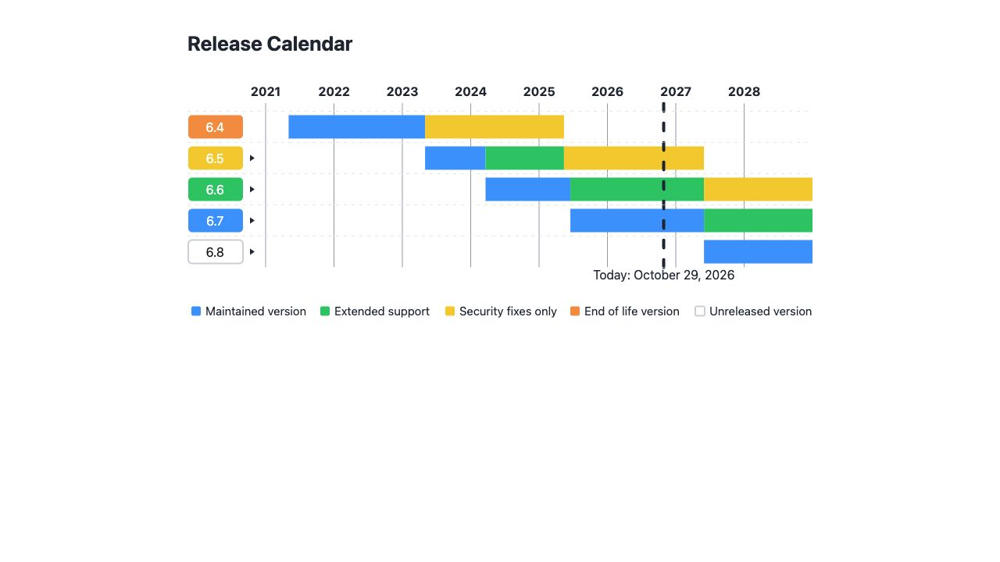
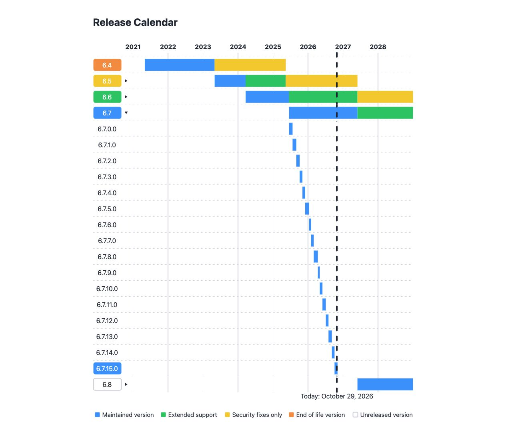

## Shopware Release Schedule

This repository provides an up-to-date calendar and structured information about Shopware’s product release schedules, including automated generation and publishing of SVG assets that visualize the release lifecycle. The schedule and SVG graphics help the Shopware community, partners, and users track upcoming releases, understand version timelines, and plan upgrades.

## What’s Included?

- **Release Timetable**:  
  - Versioned product releases for Shopware (minor and major versions)
  - Support and End-of-Life (EOL) dates
  - Major milestones such as feature freeze and release candidates

- **SVG Generation & Publishing**:  
  - Automated scripts generate SVG diagrams visualizing the current release schedule (e.g., version timelines with active/support phases).
  - The generated SVG files are published directly to the repository for easy linking in documentation, websites, or dashboards.

- **Structured Data**:  
  - Human-readable tables (Markdown, HTML)
  - Machine-readable formats for tool integration

## SVG Generation and Publishing Workflow

1. **SVG Generation**  
   - The repository contains a script that processes the latest release data (typically from a YAML, JSON, or Markdown source file).
   - The script transforms this structured data into an SVG diagram illustrating the release schedule.

2. **Automated Publishing**  
   - After generation, the SVG file (e.g., `schedule.svg`) is placed in the repository — typically in the root or a dedicated assets directory (e.g., `/assets/`).
   - In most setups, SVG generation is triggered automatically via a CI workflow (e.g., GitHub Actions) whenever the schedule data is updated.
   - With each change, the freshly generated SVG is committed and pushed alongside the updated schedule data, ensuring users always have access to the current visual representation.

3. **Usage**  
   - The published SVG can be embedded in documentation, linked from the main README, or displayed on external sites via its raw GitHub URL.
   - Example inclusion in Markdown:
     ```
     
     ```

- Browse the schedule in Markdown or JSON to keep track of planned and historical releases.
- View or embed the SVG to display a visual representation of the Shopware release lifecycle.
- Integrate the structured data or SVG in your processes, dashboards, or customer documentation.

## Example

| Version   | Release Date | End of Life | Notes                  |
|-----------|-------------|-------------|------------------------|
| 6.6.0     | 2024-06-07  | 2025-12-07  | Latest stable version  |
| 6.5.0     | 2023-05-15  | 2024-12-01  | Previous stable        |
| ...       | ...         | ...         | ...                    |

View the latest visual in [`schedule.svg`](./schedule.svg).


## Contributing

If you notice outdated or incorrect dates, please open an issue or submit a pull request. Updates to the release schedule will automatically trigger SVG regeneration and publishing.

## Branch overview and expandable minor releases

The data source remains `shopware/shopware/releases.json` on `trunk`. A flat
array can contain branch records alongside the existing minor release records:

```json
{
  "type": "branch",
  "version": "6.7",
  "release_date": "2025-06-17",
  "maintained_eol": "2027-06-01",
  "extended_eol": "2029-06-01",
  "security_eol": "2031-06-01"
}
```

A branch record owns the maintained, Extended Support and security periods.
`maintained_eol: false` means that no transition has been scheduled: the
maintained bar reaches the current calendar edge. `security_eol: false` means
no security EOL has been assigned. Neither value invents a future release date.
The meaning of `extended_eol: false` is unchanged: no Extended Support period.

Minor records keep their existing format and timing: maintained until the next
minor of the same branch, or 31 days when there is no next minor. There is no new
31-day maximum. In branch mode, minor details show this maintained period only;
support for the whole branch appears on its overview row.

The publisher still uploads one `release-schedule/schedule.svg` object. Its
default view is the overview. Named SVG views allow the release-notes page to
use native HTML `details` without JavaScript or additional published files:

- `schedule.svg#calendar-years`: shared year header.
- `schedule.svg#branch-6-7`: the 6.7 overview row (the same pattern works for other branches).
- `schedule.svg#minors-6-7`: the 6.7 minor rows.
- `schedule.svg#calendar-legend`: the existing Today marker and legend.

The calendar width and date range are unchanged. Data without branch records
uses the existing renderer, so the generator can be released before the data
and page changes.

Run the dependency-free rendering regressions with:

```sh
php tests/ReleaseScheduleTest.php
```

For a local SVG, use the existing generate command with `--path releases.json`.
To publish this behavior, first release a new generator PHAR, then merge the
branch data in Shopware and regenerate the public SVG. The release-notes page
can use the named views after that SVG has been published.

### Preview

Local browser preview with the proposed branch data, generated on 29 October 2026.




